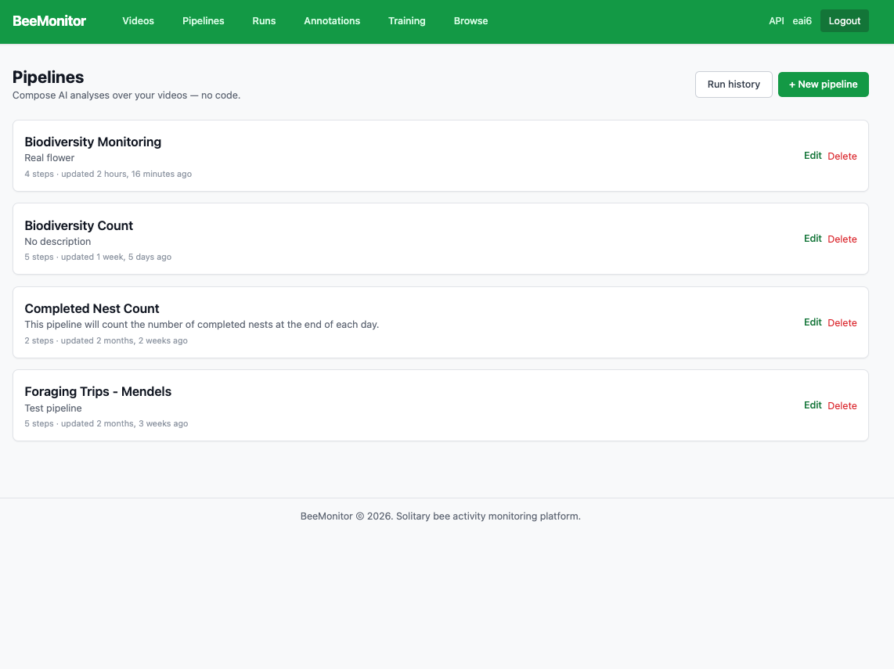
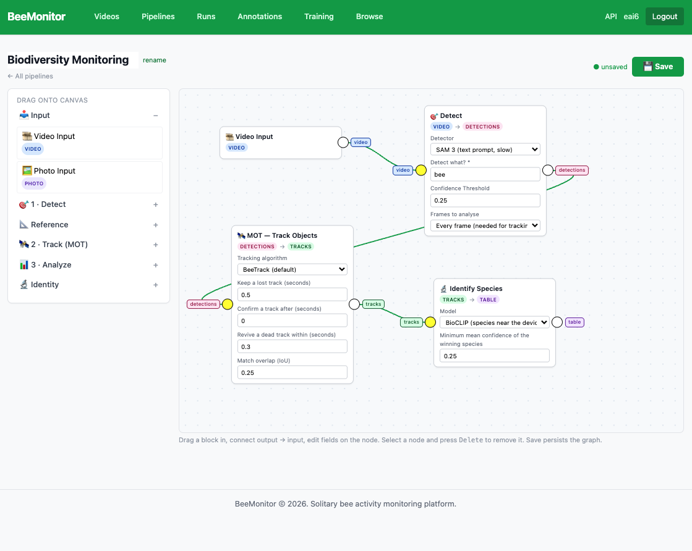

# Pipelines

A pipeline is a chain of steps run on each clip: detect, track, measure against a reference. It doesn't
name a clip; you choose the clips when you run it. The [steps and templates](#steps) are listed below.

## Build one

**Pipelines** lists your pipelines. **+ New pipeline** starts one, from scratch or from a template
(Foraging trips, Flower / ROI visitation, Pollen assay, Interactions, Individual bee IDs). **Run history**
goes to [Runs](runs.md).

<figure markdown>
  
  <figcaption>Pipelines.</figcaption>
</figure>

In the editor, drag blocks from the palette onto the canvas, connect each output to the next block's input,
and set each block's options on the node. **Save** keeps it.

<figure markdown>
  
  <figcaption>A biodiversity-monitoring pipeline: detect bees, track them, and name each track's species.</figcaption>
</figure>

## Run it

- **On clips:** in **Videos**, select clips (or all that match the filter), choose the pipeline and
  **Run pipeline**. Each clip becomes a run, and together they form a batch.
- **On photos:** in **Videos → Photos**, the same, with pipelines that start from a **Photo Input**. Each
  photo's run shows the photo with a box on every insect, each insect's crop and species, and the counts;
  the batch shows insects per photo over time, species totals and a photos CSV.
- **On a schedule:** on the device page, under **Scheduled processing**, run a pipeline on each day's new
  clips — or, for a photo pipeline, its new photos.
- **From code:** see [API](api.md).

Runs that use the GPU (Detect, Track, Identify species) use your account's credits.

## See the output

Every run and batch is listed under [Runs](runs.md), with its tables and CSV downloads.

## Steps

| Step | What it does |
|---|---|
| **Video** / **Photo** | The clip, or the photo, being analysed. Every pipeline starts from one of the two. |
| **Detect** | Finds one class in each frame with YOLO (fast) or SAM 3 (text prompt, slower). Can analyse every frame (needed for tracking) or a sample of frames (for objects that don't move). |
| **MOT: Track objects** | Links detections into tracks. Choose the algorithm — BeeTrack (default), ByteTrack, BoT-SORT, OC-SORT or SFSORT — and tune its settings on the node. Runs inside the same GPU pass as Detect, on whatever Detect found. |
| **Reference: Saved layout** | Each clip's saved ROI and reference objects (nest holes, flags, tubes, flowers): the clip's own if it has one, otherwise its site's, otherwise its unit's. Draw them from the clip page (**ROI & reference objects**), from **Videos → Sites**, or on the unit page. No GPU needed. For objects that move, wire a Detect node to the analyzer's reference input instead. |
| **Events** | One row per exit from, enter into, or stay in a reference, judged from where each track was first and last detected ([what an event is](runs.md#what-an-event-is)). |
| **Interactions** | One row per spell of contact: insect with reference (a visit), insect with insect, or both. |
| **Detection count** | Distinct objects, most common count per frame, totals, per frame, or binned over time. |
| **Identify species** | After tracking, classifies every saved crop of each track and gives the track the species with the most votes. Model: BeeMachine (354 bee taxa) or BioCLIP (limited to species recorded near the device). The species and its mean confidence go in the tables; filter on the confidence yourself. |
| **Read bee marker** | The same vote, over every crop, for each track's paint mark, to tell individuals apart. |

### Templates

Each template is the same few steps put together in a different way:

| Template | Steps |
|---|---|
| **Foraging trips** | Video → Detect (bee) → Track → Reference (device layout) → Events |
| **Flower / ROI visitation** | Video → Detect (bee) → Track → Reference (saved layout: the flowers) → Interactions (insect ↔ reference) |
| **Pollen assay** | Video → Detect (bee) → Track → Reference (saved layout: one reference object per pollen tube) → Interactions (insect ↔ reference) |
| **Interactions** | Video → Detect (bee) → Track; Detect (nest) as the reference → Interactions (all) |
| **Individual bee IDs** | Video → Detect (bee) → Track → Read bee marker |

Copy a template and change it: swap the class ("wasp", "fly"), use your own model, add Identify species,
or add a second Detect step for a reference that moves.

### Settings worth knowing

- **Detect confidence**: the only confidence setting. Detections below it never reach tracking, so weak boxes
  can't break a track. Everywhere else the confidence is a column in the tables and you filter on it.
- **Rejoin if back within (seconds)** (Interactions): how long an insect can leave a reference, or another
  insect, and still be the same interaction. Default 0.6 s.
- **Minimum interaction length** (Interactions): default 0, so every pass over a reference is kept, with its
  duration.
- **Padding** (Events, Interactions): grows every reference by this many body lengths. Default 0.
- **Insect ↔ insect radius** (Interactions): how close two insects must be, in body lengths, to count as near
  each other. Default 2.
- **Score events with the ML classifier** (Events): off by default. On, every exit and enter gets an
  `ml_confidence` column; nothing is removed.
