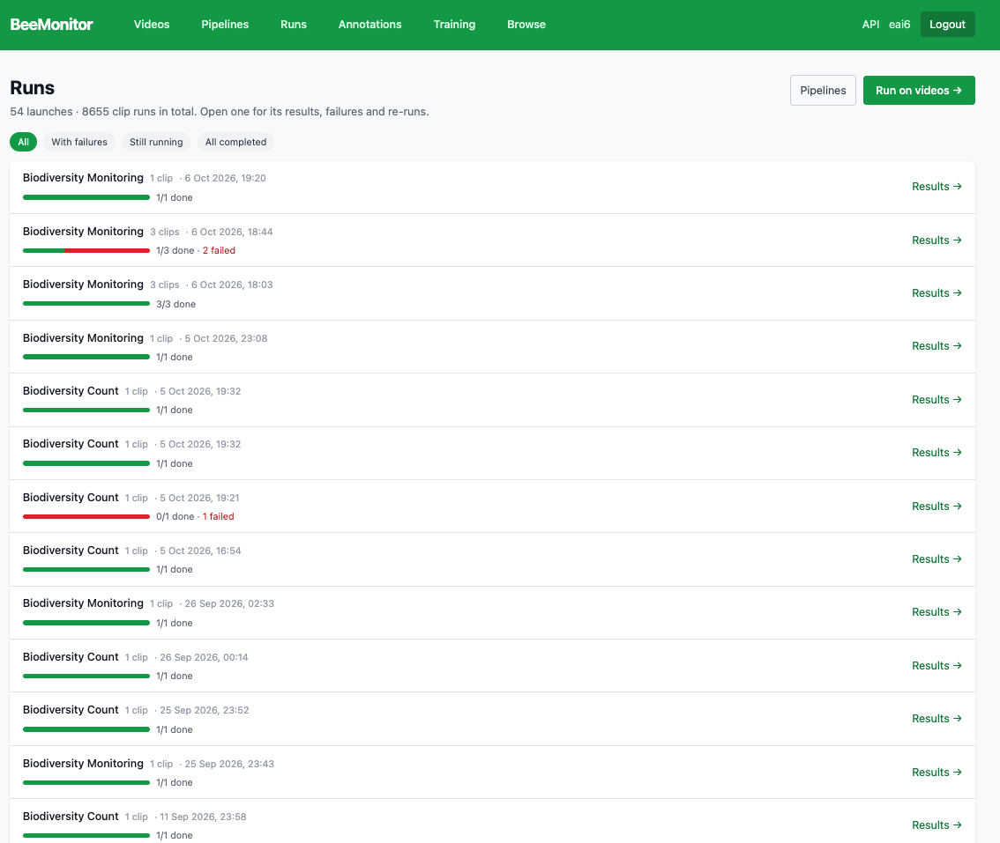
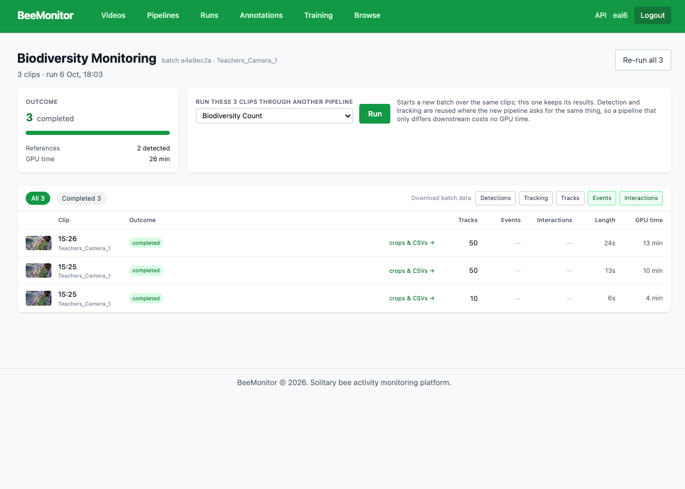
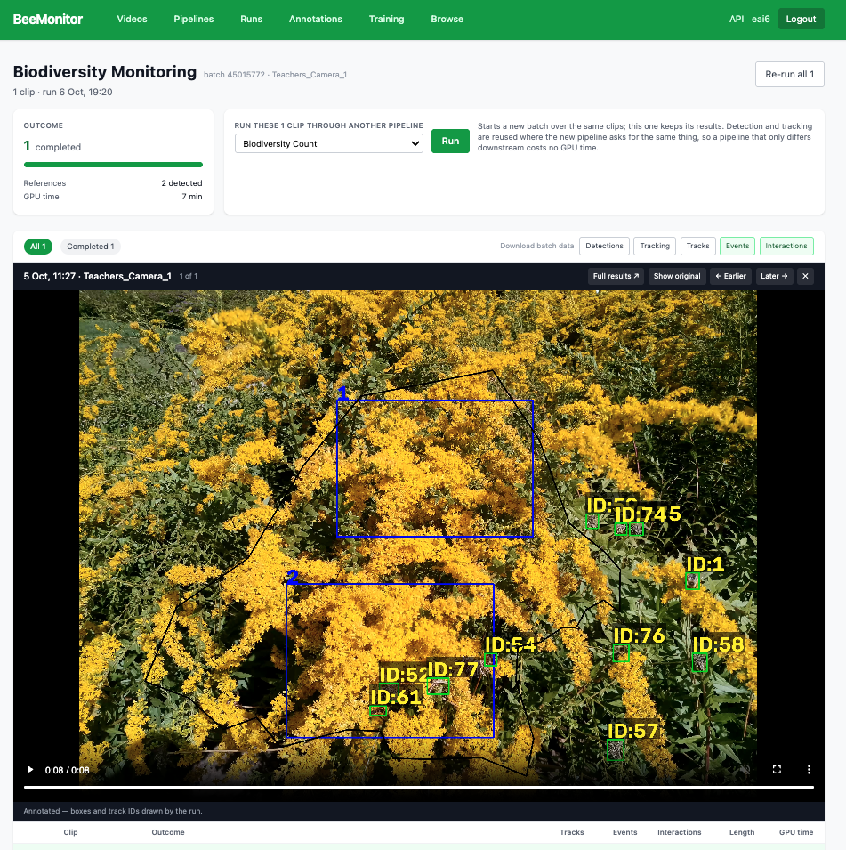
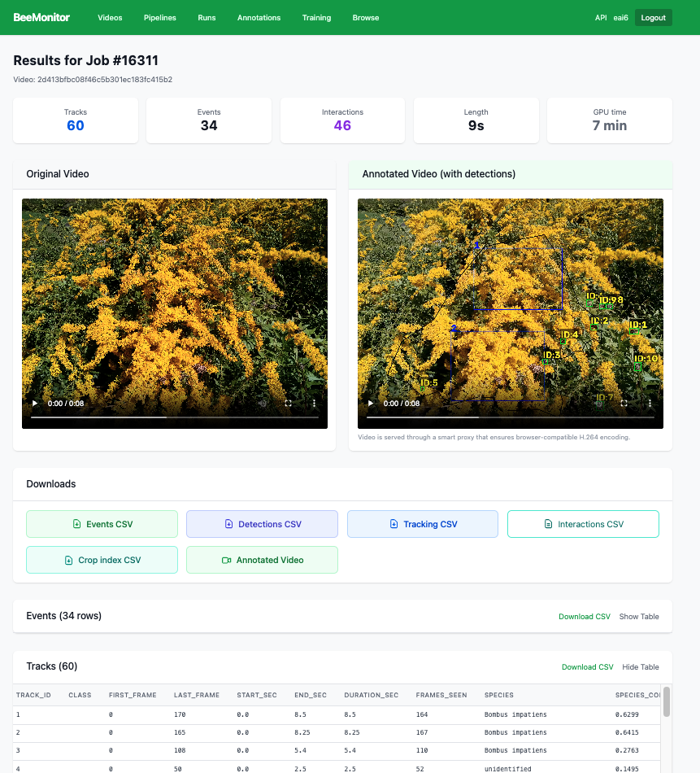
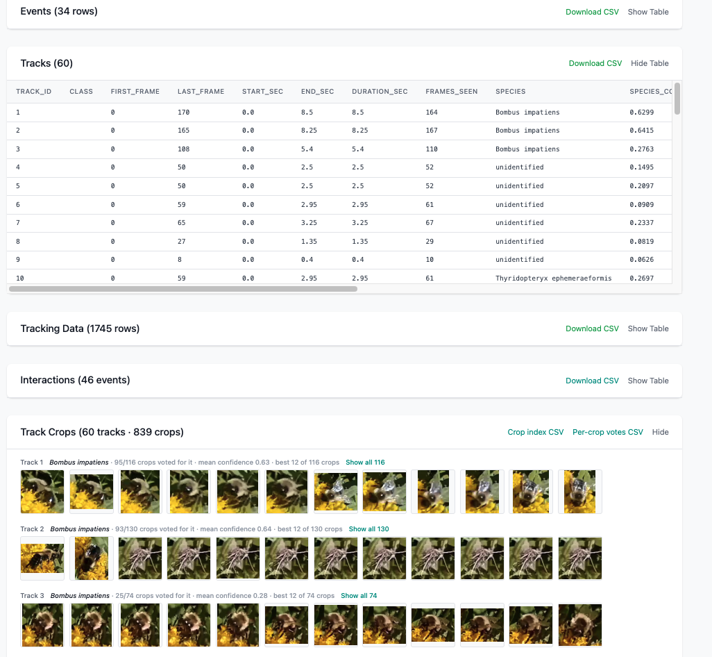

# Runs

**Runs** lists everything you've run, newest first. Running a pipeline on several clips at once is a
*batch*, one run per clip. Each row shows the pipeline, how many clips, when, and how many finished or
failed. Filter by **With failures**, **Still running** or **All completed**, and open one with **Results →**.

<figure markdown>
  
  <figcaption>Runs.</figcaption>
</figure>

## A batch

The batch page combines its clips:

- **Outcome:** how many clips finished or failed, how many references were found, and the GPU time.
- **Run these clips through another pipeline:** a new batch over the same clips. Detection and tracking
  are reused where the new pipeline asks for the same thing, so a pipeline that differs only downstream
  costs no GPU time.
- **Download batch data:** one CSV per table for every clip in the batch, each row labelled with its clip,
  device, site and the clip's recorded start: **Detections**, **Tracking**, **Tracks**, **Events** and
  **Interactions**, plus **Photos** for a photo batch. Only tables the batch produced are offered.
- **Per clip:** each clip's outcome, tracks, events, interactions, length and GPU time.

<figure markdown>
  
  <figcaption>A batch of three clips.</figcaption>
</figure>

When clips fail, the page groups them by cause. You can rerun only the failed clips or the whole batch
(**Re-run all**). A rerun is a new batch, and the old one is kept for comparison.

Click a clip to play its annotated video in place, with each track's box and ID and the reference objects;
**Show original** switches to the clip as recorded, and **Earlier** and **Later** step through the batch.

<figure markdown>
  
  <figcaption>A clip in its batch, annotated: reference objects 1 and 2, and every track with its ID.</figcaption>
</figure>

## A clip's results

**Full results** (or **crops & CSVs →** on a clip's row) opens the clip's results page:

- counts of tracks, events and interactions, its length and GPU time;
- the clip with its tracks drawn over it as it plays (below);
- downloads of every table, the crop index and the rendered video;
- the **Tracks**, **Tracking**, **Events** and **Interactions** tables, each with its own CSV download.

### The player

The clip plays with its tracks drawn over it. Under **Show** you choose what's drawn:

- **Boxes and ids**, **Species on the label**, **Trails (last 2 s)**, and **Lost tracks** (dashed: the tracker
  had lost the insect and was guessing where it was).
- **ROI and reference objects**: the pipeline's ROI in green, each reference object in white with its number.
- **Events**: a label next to the insect: **EXIT 3** for the 1.5 s after it comes out of reference 3,
  **ENTER 3** for the 1.5 s before it goes in, **STAY 3** for as long as it stays. The reference glows blue,
  amber or violet while the label shows.
- **Interactions**: while an insect is in a reference, that reference is drawn in the insect's colour and the
  insect's label counts the seconds (`in 3 · 2.3 s`). Two insects near each other are joined by a line
  labelled with their distance in body lengths.

Under the video, the event bar marks every event in the clip (exit blue, enter amber, stay as a violet span);
click one to jump there. With **Events by tube** on (the default), it splits into one lane per tube, busiest
first, so each mark says when *and* at which tube; the numbers beside a lane are its exits / entries. Click a
tube's name to show only that tube's events on the video, and again to show them all. More than eight tubes
fold into "+ N more tubes". **Events near now** lists the events within 5 seconds of the current frame.

Click a box to follow one track. The **full window** button (top right of the video), or a double-click,
fills the screen with the video and everything drawn on it.

**Render video** makes an MP4 of the clip drawn exactly as the player draws it, with the layers you tick
(plus an optional clock showing the clip time and timestamp). It runs on a GPU, and the dialog shows the
cost in GPU-hours before you start. The events and interactions drawn are the run's saved rows, the same
ones in its CSVs.

<figure markdown>
  
  <figcaption>A clip's results. The Tracks table names each track's species and its confidence.</figcaption>
</figure>

**Track crops** shows each track's sharpest 12 crops, with its species, how many crops voted for it and
their mean confidence. **Show all** loads every crop, and clicking a crop enlarges it in place. **Per-crop
votes CSV** has what the model read from each crop.

<figure markdown>
  
  <figcaption>Track crops, labelled by species vote.</figcaption>
</figure>

A photo's run shows the photo with a box on every insect, each insect's crop and species, and the counts.

## Review events and trips

People check the detected events by hand. A review never changes what was detected: the call is kept
beside it, and the Events CSV says what reviewers decided.

**Who can review.** Whoever launched the batch, and anyone they invite as a **Reviewer** from **People** on
the batch page (by username or email). A **Viewer** can watch and download but not vote. Invited batches
appear under **Runs › Shared with me**. The public link stays view-only.

**On a clip.** Next to each event in **Events near now**, click **Yes** or **No**; click again to take your
vote back. **Review events** plays the clip from 2 seconds before each event, pauses on it and asks
"Is this right?": **Yes (Y)**, **No (N)**, **Replay 2 s (R)** or **Skip (→)**. After a No you can say what's
wrong (not an event, wrong tube, wrong action, can't tell). Reviewed marks on the tube lanes get a ring:
green accepted, red rejected, amber where reviewers disagree.

**Over a period.** **Review a period** (on a unit's page, or **Review this period** on a batch from one unit or
site) puts every analysed clip between two times — a few hours or up to a week — on one time axis. A strip
shows the clips (striped where nothing was recorded), and the tube lanes run across the whole period, so a
bee leaving in one clip and coming back in a later one sit on the same lane. **Review events** walks every
event in the period in time order, moving from clip to clip by itself. Click a tube's name to list its events
across the period.

**Trips.** A faint band joins each exit to the next entry into the same tube, across clips too (the next entry
by the same marker first, when markers were read). These are suggestions only. **Review trips** plays each
one in the player: 2 seconds either side of the exit, then 2 seconds either side of the entry, following the
bee each time. **Exit ±2 s**, **Entry ±2 s** and **Whole trip** replay a part (the whole trip runs from the exit
to the entry across clips, skipping time with no recording), and the trip bar lets you jump to any moment in
between. Below the player are the bee that left and the bee that came back, with their species, marker and
crops. Then it asks whether it is the same bee:

- **Same bee, a trip (Y)** accepts it.
- **Not this pair (N)** lets you link the exit to a different later entry into that tube, or mark
  "didn't come back in this period" or "can't tell".

**What it adds to the data.**

| Where | What |
|---|---|
| Events CSV (clip and batch) | `review` (accepted, rejected, disputed when reviewers disagree, blank if unreviewed), `reviewed_by`, `review_notes` |
| Clip page | "12 reviewed · 9 accepted · 3 rejected" under Events |
| Batch table | a **Reviewed** column |
| **Reviewed trips** CSV (period page and batch) | one row per pair a reviewer called: `reference, exit_time, entry_time, duration_sec, exit_clip, exit_track, entry_clip, entry_track, species, marker_id, review, reviewed_by, review_notes` |

Only reviewed trips are ever exported. A suggestion nobody looked at is not a trip in your data.

## The tables

Tracking produces two tables, and every study is answered from them. BeeMonitor doesn't have a separate
"foraging" or "flower" analysis. Time on a flower is a sum over interactions, and a foraging trip is a pair of
events. You derive what your study needs.

| Table | One row is | Answers |
|---|---|---|
| **Events** | An insect came out of a reference, went into one, or stayed in one | Arrivals, departures, foraging trips |
| **Interactions** | An insect was in a reference, or near another insect, for a span of time | Visits, time on a flower or in a zone, encounters |

A run has the tables its pipeline has steps for: an **Events** step makes the Events table, an
**Interactions** step the Interactions table. A table the pipeline has no step for shows "—" everywhere
(the batch, the clip page, the downloads) and is never computed behind your back; add the step and rerun to
get it.

Both are computed on the platform from the tracking table, against the **references your pipeline defines**:
a Reference (saved layout) step, or a Detect step for the reference class wired into the analyzer. Nothing
else is used. If the pipeline has no reference, there are no events and no insect-to-reference interactions,
and the results page says so.

Beside them, the **Tracks** table lists each animal once, with its species and marker ID, and the
**Tracking** table has every frame of every track.

### What an event is

An event is judged from where a track **starts** and **ends**: the first and last frames in which the insect
was actually detected. When the tracker loses an insect it keeps guessing where it is for up to a second;
those guessed positions never count.

| The track… | Events |
|---|---|
| starts in a reference and is later somewhere else | **exit** from it, at the start |
| ends in a reference and was earlier somewhere else | **enter** into it, at the end |
| starts in tube 3, flies around, ends in tube 3 | **exit** tube 3 and **enter** tube 3 |
| starts in tube 3, ends in tube 5 | **exit** tube 3 and **enter** tube 5 |
| starts and ends in tube 3 and never leaves it | **stay** in tube 3, with how long it stayed (it came to the entrance and turned round, or sat there) |
| passes over references but neither starts nor ends in one | no event. Each pass over is an interaction, with its duration |

How long the insect spent in the reference doesn't matter: exits are often a fraction of a second.

"In a reference" means the centre of the insect's box is inside the reference's outline. The Events step's
**Padding** grows every reference by that many body lengths (the long side of the insect's own box).

References shouldn't overlap. If two do, the results warn you and name them, and a point in both counts
once, for the reference whose centre is nearest.

### Times

Every table gives times, not frame numbers:

- `timestamp` (or `start_time` / `end_time`) is the clip's recorded start plus the seconds into the clip, in
  local time with its offset, to the millisecond. It's blank when the clip's start time isn't known.
- `clip_sec` (or `start_clip_sec` / `end_clip_sec`) is the seconds into the clip, always filled. It's what the
  video player seeks to.
- `clip_start` (batch downloads) is the clip's recorded start, so you can fill in a start time yourself and add
  `clip_sec` to it.

An uploaded clip's time comes from its name (`site_YYYYMMDD_HHMMSS`), read as the site's local time. Set each
site's time zone on **Videos → Sites**; until you do, times from that site have no offset.

### Events

| Column | Meaning |
|---|---|
| `timestamp`, `clip_sec` | When: the start for an exit or a stay, the end for an enter |
| `track_id` | The insect |
| `action` | `exit`, `enter` or `stay` |
| `reference` | The reference, for example `reference_3` (the id from your layout, the same across a site's clips) |
| `duration_sec` | For a stay: how long it stayed |
| `at_edge` | `true` for an exit on the first frame analysed or an enter on the last (the insect may have been there before recording started, or still there after it stopped). Blank for an enter or a stay when the clip's length is unknown |
| `ml_confidence` | 0–1, the event classifier's score, when **Score events with the ML classifier** is on in the Events step. Nothing is removed; filter on it yourself |

### Interactions

One row per unbroken spell. A gap longer than the step's **Rejoin if back within** setting, or a move to
another reference, ends it.

| Column | Meaning |
|---|---|
| `start_time`, `end_time`, `start_clip_sec`, `end_clip_sec` | When it started and ended |
| `duration_sec` | The time the insect was detected there |
| `track_id` | The insect |
| `with` | A reference (`reference_3`) or another insect's track id |
| `relation` | `in_reference`, or `near` (two insects within the step's radius, in body lengths) |
| `min_distance_bl` | For `near`: the closest they came, in body lengths |

### Tracks

One row per track: when it was detected and what it was. Species and marker IDs come from a vote over every
crop of the track (the **Identify species** and **Read bee marker** steps). They're blank when the pipeline
has neither step.

| Column | Meaning |
|---|---|
| `track_id` | The track, as in the other tables |
| `start_time`, `end_time`, `start_clip_sec`, `end_clip_sec`, `duration_sec` | First and last detection |
| `species`, `species_confidence` | The winning species and its mean confidence. Filter on the confidence yourself |
| `species_votes`, `species_vote_share` | Crops that voted for it, and their share of all crops |
| `marker_id`, `marker_votes`, `marker_vote_share` | The marker read on the most crops |

The same species and marker columns are added to the events, interactions and tracking downloads for the
track each row is about. On an interaction between two insects, the other one's are `with_species` and
`with_marker_id`.

### Tracking

One row per track per frame.

| Column | Meaning |
|---|---|
| `frame`, `timestamp`, `clip_sec` | The frame and its time |
| `track_id` | The track |
| `detected` | `1` when the detector found the insect in this frame, `0` when the tracker only guessed where it was |
| `x1`, `y1`, `x2`, `y2`, `cx`, `cy` | Its box and centre, in pixels |
| `confidence` | The detection's confidence (blank on guessed frames) |
| species and marker columns | As in Tracks, plus `marker_method` and `marker_confidence` |

## From the tables to your question

The setup decides what the *reference* is: a nest tube, a flower, a zone in an arena. The analysis is
always the same read.

| Question | Read |
|---|---|
| Foraging trips at a nest | Events: each `exit` from a tube paired with the next `enter` into it; trip length = the time between them |
| Visits to a flower | Interactions with `relation = in_reference`, counted per `with` |
| Time on a flower (dwell) | The same rows, summing `duration_sec` per `with` |
| Pollen assay: which tube bees prefer | Interactions per pollen tube (`with`): count the rows, sum `duration_sec` |
| Insect-to-insect encounters | Interactions with `relation = near` |
| Turning round at the entrance | Events with `action = stay` |
| Activity through the day | Bin events or interactions by `timestamp`, or use **Detection count** |
| Per individual or per species | Use the `marker_id` or `species` columns |

```python
import pandas as pd

ev = pd.read_csv("events.csv", parse_dates=["timestamp"])
ia = pd.read_csv("interactions.csv")

# Time on each flower (or zone)
on_ref = ia[ia.relation == "in_reference"]
dwell = on_ref.groupby("with").agg(visits=("track_id", "size"),
                                   total_sec=("duration_sec", "sum"),
                                   mean_sec=("duration_sec", "mean"))

# Foraging trips: exit from a tube, then the next entry into the same tube
ev = ev[ev.action != "stay"].sort_values("timestamp")
ev["next_action"] = ev.groupby("reference").action.shift(-1)
ev["next_time"] = ev.groupby("reference").timestamp.shift(-1)
trips = ev[(ev.action == "exit") & (ev.next_action == "enter")].assign(
    trip_sec=lambda d: (d.next_time - d.timestamp).dt.total_seconds())
```

The run and batch pages show these tables, and you can always download them as CSV to derive your own
measures.

## Provenance and limits

- Events and interactions depend on the references and the step settings. If you change either, rerun the
  pipeline.
- Every run is recounted with these rules from the tracks it already saved; nothing needs rerunning. Clips
  tracked before 29 October 2026 don't record which frames were detections, so their track starts and ends
  may include the tracker's guessed positions, and their results say so. Rerun tracking to measure those
  from detections only.
- Times assume a constant frame rate. A clip recorded at a variable frame rate (some phones) is marked on its
  page.
- Track ids identify an animal *within one clip*. To follow an individual across clips, mark the bees and add
  the **Read bee marker** step.
