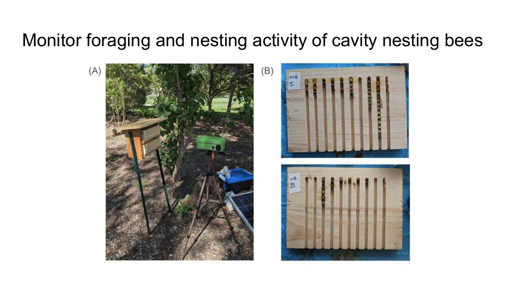
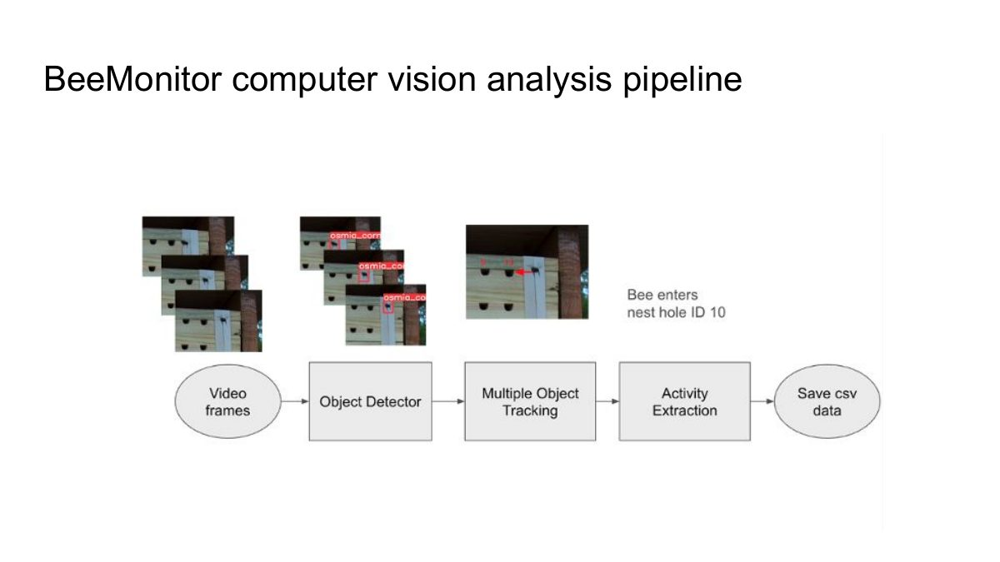
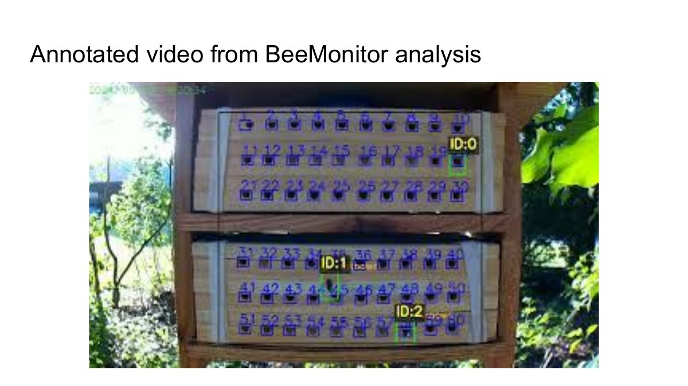

# Day 1 · The project and the hardware

An overview of the BeeMonitor project for research on pollinator foraging and nesting, then how to
assemble a BeeMonitor unit and deploy it in the field.

  <iframe src="https://www.youtube-nocookie.com/embed/1DA3gvVxayM" title="Day 1: BeeMonitor overview, build a unit, and deploy it" loading="lazy" allow="accelerometer; encrypted-media; gyroscope; picture-in-picture; fullscreen" allowfullscreen></iframe>

[Watch on YouTube](https://youtu.be/1DA3gvVxayM){ .md-button }

## In this session

1. **Why BeeMonitor:** watching pollinators at nest hotels and flowers on video, and the questions it
   answers, such as when bees forage, how long their trips take, and which species visit.
2. **How a unit works:** a camera that records only when insects are active and uploads its clips to the
   platform by itself.
3. **Building a unit:** the parts, and the ten assembly steps.
4. **Deploying it:** power in the field, pointing the camera at the site, and adding the unit to your
   account.

## Slides

<figure markdown>
  
  <figcaption>Monitoring foraging and nesting of cavity-nesting bees: (A) a unit at a nest hotel, (B) the nest blocks opened.</figcaption>
</figure>

<figure markdown>
  
  <figcaption>From video to data: detect each bee, track it from frame to frame, then extract activity such as "bee enters nest hole 10".</figcaption>
</figure>

<figure markdown>
  
  <figcaption>Annotated video from an analysis: every nest hole numbered, every bee tracked with an ID.</figcaption>
</figure>

## Class discussion

- What did you name your BeeMonitor?
- How do you hope to use automated monitoring in your own research?

## Follow along

- [Build a unit](../hardware/index.md): the parts list, costs and every assembly step with pictures. The
  [printable manual](../assets/BeeMonitor-Assembly-Manual.pdf) is the same steps on paper, for the bench.
- [Step 10 · Power the BeeMonitor](../hardware/index.md#step-10-power-the-beemonitor): wall socket,
  battery, or battery and solar panel.
- [Get started](../get-started.md#1-get-video-in): add the unit on the platform's
  [Add a device](https://beemonitor.edwardamoah.com/devices/enrollment) page.
- [Devices](../platform/devices.md): check the unit is online, see its camera picture, and set when it
  records.

## Try it yourself

1. Assemble a unit, or follow the steps in the manual if you don't have the parts.
2. Add it to your account and open its device page. Check it shows as online with a recent camera picture.
3. Aim it at a nest hotel or flower patch, so the area you study fills most of the picture.
4. Let it record for a day, then find its clips under **Videos**.

??? question "Check your understanding"
    - Why does a unit record only when insects are active, and not all day?
    - Which power option would you use at a field site with no mains power for a whole season?
    - Where on the platform do you see whether a unit is online, and how full its card is?

[Next: Day 2 · Build a pipeline →](day-2.md){ .md-button .md-button--primary }
