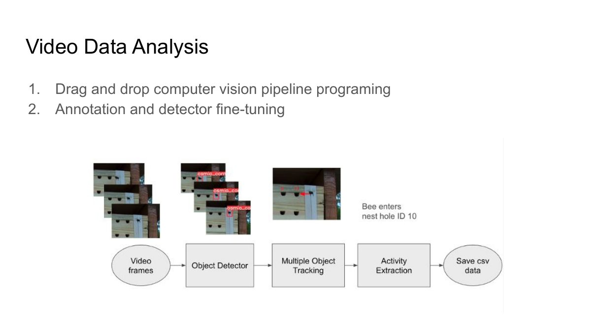
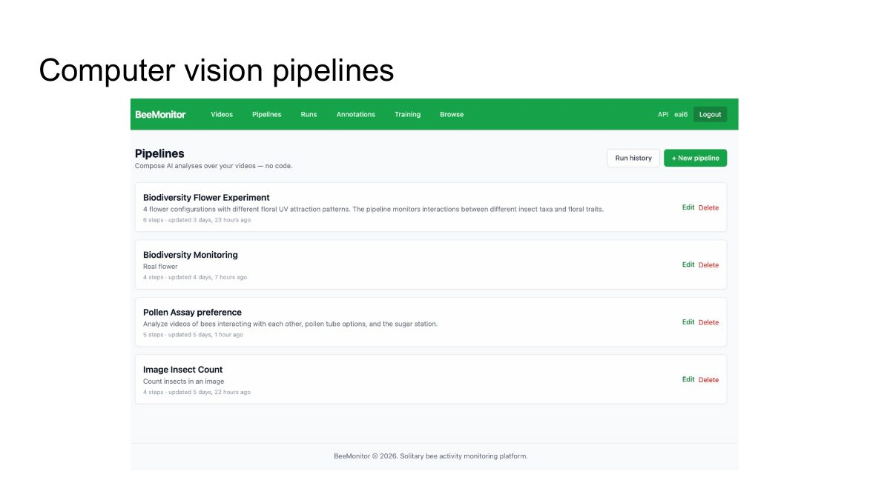
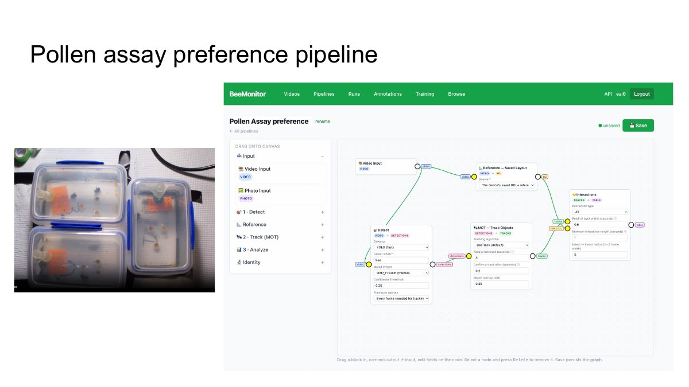
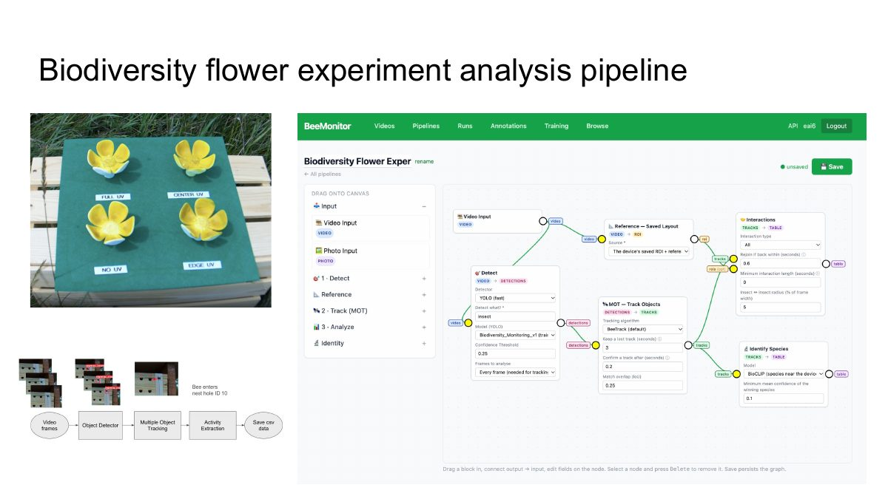
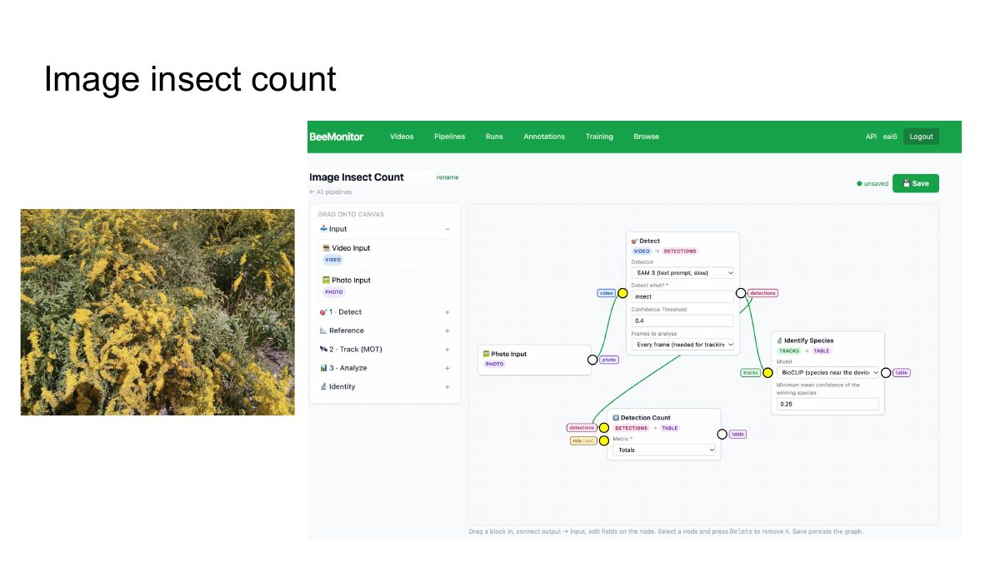

# Day 2 · Build a pipeline

How to build a computer-vision pipeline on the BeeMonitor platform, by dragging blocks together, and run it
on video or photos collected in the field.

  <iframe src="https://www.youtube-nocookie.com/embed/mdiGMfCo6Lk" title="Day 2: BeeMonitor computer vision pipelines with drag and drop" loading="lazy" allow="accelerometer; encrypted-media; gyroscope; picture-in-picture; fullscreen" allowfullscreen></iframe>

[Watch on YouTube](https://youtu.be/mdiGMfCo6Lk){ .md-button }

## In this session

1. **Getting data in:** clips from a unit, or videos and photos uploaded from any camera.
2. **The pipeline editor:** dragging blocks onto the canvas and connecting each output to the next input.
3. **The blocks:** detect insects, track them from frame to frame, measure what they do against a reference
   (a nest tube, a flower), and name their species.
4. **Running it:** choosing clips, running the pipeline on them, and reading the results.

## Slides

<figure markdown>
  
  <figcaption>The two parts of video analysis on the platform.</figcaption>
</figure>

<figure markdown>
  
  <figcaption>One platform, many studies: each is a pipeline.</figcaption>
</figure>

Three of those pipelines, as built in the editor. The first two use detectors fine-tuned on the platform,
which is day 3's topic:

=== "Pollen assay preference"

    <figure markdown>
      
      <figcaption>Which pollen options bees visit in a lab arena: detect with a fine-tuned model, track, then interactions with the saved reference objects.</figcaption>
    </figure>

=== "Flower experiment"

    <figure markdown>
      
      <figcaption>Which insects visit which flower (full, center, edge or no UV), for how long, and what species they are.</figcaption>
    </figure>

=== "Insect count from photos"

    <figure markdown>
      
      <figcaption>Counting and naming insects in photos: SAM 3 finds every insect from a text prompt, with no training.</figcaption>
    </figure>

## Follow along

- [Get started](../get-started.md): the three steps of every study, and what each kind of block does.
- [Pipelines](../platform/pipelines.md): building one, the templates, and every step's settings.
- [Videos](../platform/videos.md): finding clips, and drawing an ROI and reference objects for a site.
- [Runs](../platform/runs.md): a batch's results, the tables, and the CSV downloads.

## Try it yourself

The in-class activity: **build a pipeline for foraging activity analysis.**

1. **Pipelines → + New pipeline**, from the **Foraging trips** template, or start from scratch with
   **Video Input → Detect → MOT: Track objects → Events**.
2. Draw the reference objects for your site: in **Videos → Sites**, mark the nest tubes or flowers your
   insects visit.
3. In **Videos**, select a few clips from one morning and **Run pipeline**.
4. Open the batch under **Runs**. Play one clip's annotated video and check each track follows one insect.
   Then download the **Events** CSV.

!!! note "Credits"
    Detect, Track and Identify species run on a GPU and use your account's credits. Start with a few clips
    to check the results before you run a whole season.

??? question "Check your understanding"
    - Why must Detect analyse every frame when you track, but not when you count objects that don't move?
    - What does a reference block give the Events step, and where does a saved layout come from?
    - You change only the last step of a pipeline and run it on the same clips again. Does it use more GPU
      time? (See [Runs](../platform/runs.md#a-batch).)

[← Day 1](day-1.md){ .md-button } [Next: Day 3 · Fine-tune and analyse →](day-3.md){ .md-button .md-button--primary }
