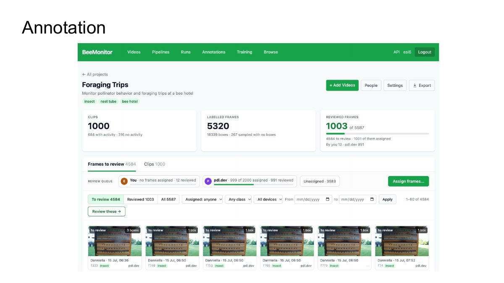
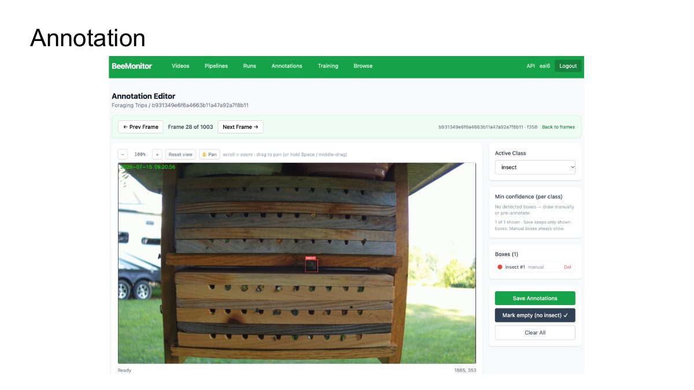
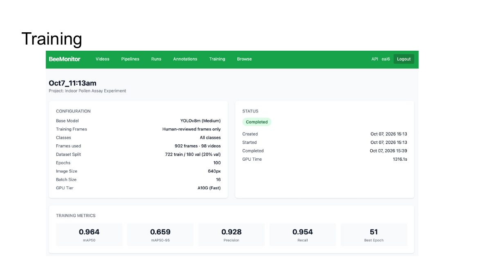
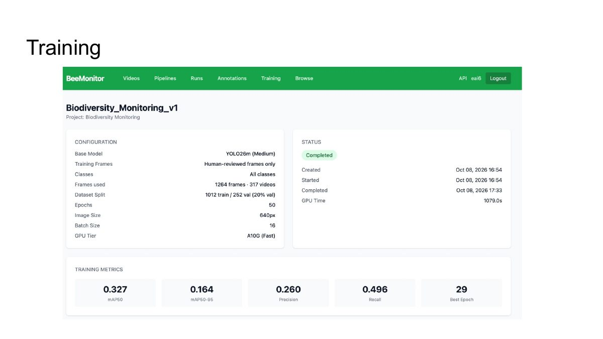

# Day 3 · Fine-tune and analyse

The results of a detector the class fine-tuned on annotations the students reviewed, and the results of
analysing field data with the pipeline built in class, set to use that detector.

  <iframe src="https://www.youtube-nocookie.com/embed/Q3GLNMydPnM" title="Day 3: reviewing a fine-tuned detector and field results" loading="lazy" allow="accelerometer; encrypted-media; gyroscope; picture-in-picture; fullscreen" allowfullscreen></iframe>

[Watch on YouTube](https://youtu.be/Q3GLNMydPnM){ .md-button }

## In this session

1. **From frames to a detector:** frames sampled from field clips, labelled automatically, then checked by
   the students.
2. **The fine-tuned detector:** its training metrics (mAP, precision and recall) and its boxes on frames it
   never trained on.
3. **Using it:** the class pipeline, with its Detect step switched to the fine-tuned model.
4. **Reading the field results:** the batch, the annotated videos, and the tables behind them.

## Slides

=== "The project"

    <figure markdown>
      
      <figcaption>The class project: frames sampled from 1,000 clips, labelled automatically, then reviewed.</figcaption>
    </figure>

=== "Reviewing a frame"

    <figure markdown>
      
      <figcaption>Checking one frame in the annotation editor.</figcaption>
    </figure>

Two detectors trained on the platform, both on human-reviewed frames only:

=== "A strong model"

    <figure markdown>
      
      <figcaption>Indoor pollen assay: 902 frames, mAP50 0.964, precision 0.928, recall 0.954.</figcaption>
    </figure>

=== "A weak model"

    <figure markdown>
      
      <figcaption>Biodiversity monitoring: 1,264 frames, mAP50 0.327, precision 0.260, recall 0.496.</figcaption>
    </figure>

Same platform, same steps, very different results. Before you use a model, look at its numbers and at its
**Validation predictions**: they tell you whether it is ready, or needs more or better-labelled frames.

## Follow along

- [Annotations](../platform/annotations.md): a project, sampling and labelling frames, reviewing them, and
  working as a team.
- [Training](../platform/training.md): training a model on a project, and what its metrics mean.
- [Pipelines](../platform/pipelines.md): choosing your model in a Detect step.
- [Runs](../platform/runs.md#from-the-tables-to-your-question): from the tables to your question, for
  example foraging trips per tube.

## Try it yourself

1. **Annotations → New project** with your classes, then **+ Add Videos**: pick clips across several days
   and hours, not one busy morning.
2. **Clips → Sample & label**, then review the frames. Fix or delete wrong boxes and add missed insects.
3. **Training → New Training Job** on the project, from the base model. When it finishes, look at the
   **Validation predictions**, not only the numbers.
4. Copy your day 2 pipeline, set its Detect step to your new model, and run both pipelines on the same
   clips. Compare the events each one finds.

!!! warning "Test on days you didn't train on"
    Frames from the same clip are nearly identical, so a model checked on frames beside its training frames
    looks better than it is. Keep a few whole days out of the project and check the model on those.

??? question "Check your understanding"
    - Why review the auto-labels instead of training on them as they are?
    - Why might the pollen-assay model score so much higher than the biodiversity one?
    - Precision is high and recall is low. What is the model doing wrong?
    - Why can missed detections make foraging trips look longer than they are?

[← Day 2](day-2.md){ .md-button } [Back to the course →](index.md){ .md-button }
