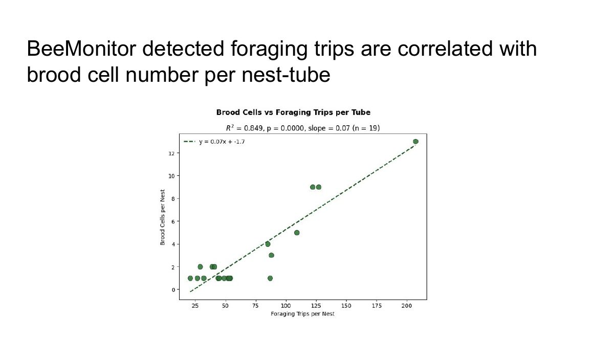

# Training course

A course on BeeMonitor, recorded in class in October 2026. Watch the videos in order. Each day's page has
the video, the slides used in class, the docs to keep open while you follow along, and a short exercise to
do on your own account.

[Download the class slides (PDF)](../assets/training/BeeMonitor-course-slides.pdf){ .md-button }

| Day | Video | You'll be able to |
|---|---|---|
| [**1 · The project and the hardware**](day-1.md) | BeeMonitor overview, build a unit, and deploy it | explain what BeeMonitor measures, assemble a unit and set it up at a field site |
| [**2 · Build a pipeline**](day-2.md) | Computer-vision pipelines with drag and drop | build a pipeline from blocks and run it on field video |
| [**3 · Fine-tune and analyse**](day-3.md) | Reviewing a fine-tuned detector and field results | judge a detector trained on your own labels, then use it to analyse field data |

## What the course covers

1. Hands-on assembly and deployment of BeeMonitor hardware.
2. Hands-on annotation, and programming computer-vision pipelines on the platform.
3. Reviewing the results of an analysis with a fine-tuned detector.

## Why it works

BeeMonitor watches cavity-nesting bees at a nest hotel and counts their foraging trips from video. In the
study the course is built on, the trips it detected per nest tube predicted how many brood cells the bee
built in that tube.

<figure markdown>
  
  <figcaption>Foraging trips per tube, detected by BeeMonitor, against brood cells counted in the same tube.</figcaption>
</figure>

## Before you start

- An account on [beemonitor.edwardamoah.com](https://beemonitor.edwardamoah.com).
- For day 1's hands-on part: the parts in [Build a unit](../hardware/index.md#parts-accessories). You can
  watch without them.
- For days 2 and 3: some video. Use clips from a unit, or upload your own from any camera
  ([Videos](../platform/videos.md#upload-from-any-camera)).

!!! tip "Teaching the course"
    For a class, create one [annotation project](../platform/annotations.md) and invite the students as
    **Reviewers** (**People → Invite**). Each one reviews a share of the frames (**Assign frames…**), and
    day 3 trains a detector on everyone's work together. Students see the sampled frames, not your sites'
    locations or source videos.
